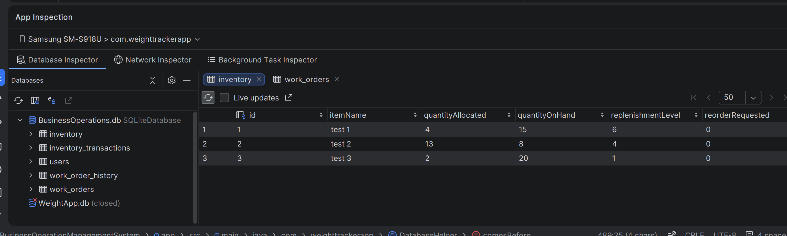

# Databases

## Enhancement Three: Database Design and Management

For this enhancement, I improved the Business Operations Management System by expanding its SQLite database to better support inventory and work order management.

I added an inventory transactions table and a work order history table to track business activity. I also implemented database relationships, data validation, and methods for storing and retrieving records.

These enhancements demonstrate my ability to design relational databases, maintain data integrity, and support business operations through organized and reliable information.

## Enhancement Files

- [Database Enhancement Narrative](Database%20enhancement.docx)
- [Enhanced BOMS Project](BusinessOperationManagementSystem.zip)

- ## Database Enhancement Screenshots

The following screenshots were captured using Android Studio's Database Inspector. They demonstrate how the enhanced SQLite database stores and manages inventory and work order information.

### Inventory Records
Shows inventory items with their quantities, allocated amounts, and replenishment levels.

### Work Order Records
Shows work orders with their assigned priorities, statuses, and descriptions.

### Inventory Transactions
Shows initial stock transactions linked to inventory items, including quantities and transaction dates.

### Work Order History
Shows work order history records, including previous and new statuses, dates, and notes.

