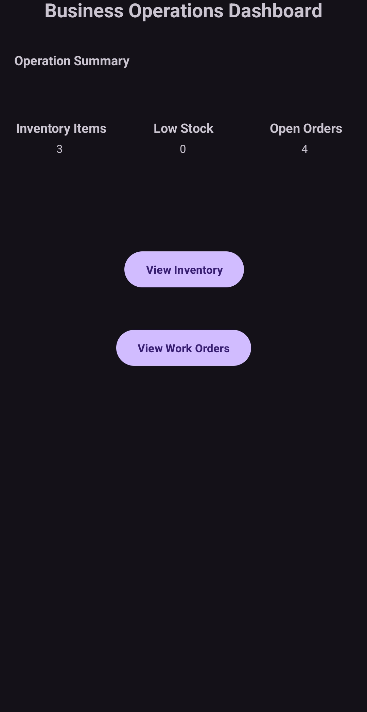

# Software Design and Engineering

## Business Operations Management System

For this enhancement, I transformed my original Weight Tracker application from CS 360 Mobile Architecture and Programming into a Business Operations Management System. The enhanced application includes inventory management, work order management, an operations dashboard, input validation, error handling, and improved password security.

This enhancement demonstrates my ability to redesign and expand an existing application to support business processes while considering usability, security, and software requirements.

## Enhancement Narrative

The accompanying narrative explains the development process, improvements made to the original artifact, course outcomes addressed, and what I learned while completing the enhancement.

### Files

[View Enhancement Narrative](Software%20design%20enhancement.docx)

[View Enhanced Business Operations Management System](BusinessOperationManagementSystem.zip)

## BOMS Application Screenshots

The following screenshots demonstrate the user interface and business management features added to the application.

### Login Screen

### Dashboard

### Inventory List

### Add Inventory Item

### Active Work Orders

